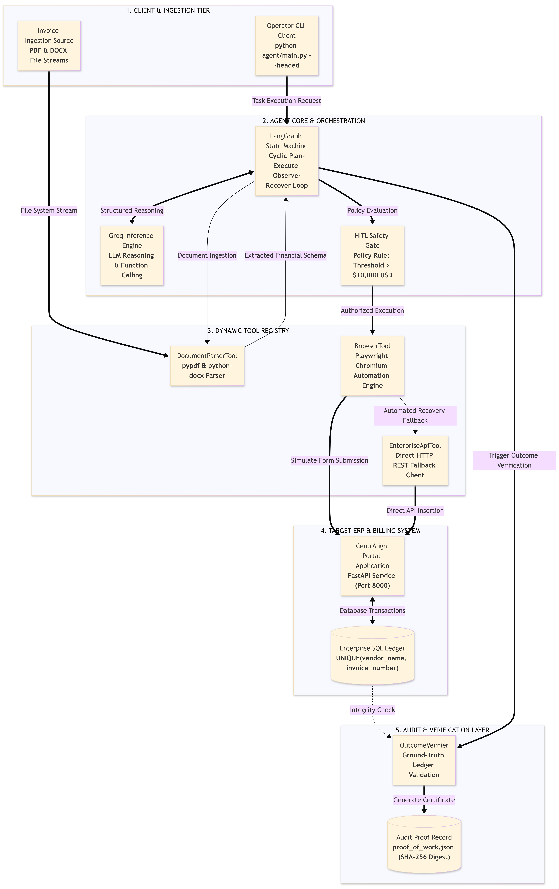

# CentrAlign - Invoice Processing Agent

An automated pipeline that monitors incoming invoice documents, extracts key financial fields, and records them into an internal ERP system using Playwright browser automation or direct REST/database calls.

The system uses a LangGraph state graph, a dynamic tool registry, an independent cryptographic outcome verifier, and a Human-in-the-Loop (HITL) gate for transactions exceeding configured monetary thresholds.

---

## Submission Links

- **GitHub Repository**: [https://github.com/Ctrl-Alt-Delusion534/Agentic_Browser_Tool](https://github.com/Ctrl-Alt-Delusion534/Agentic_Browser_Tool)
- **Demo Video**: [Google Drive Video Demo](https://drive.google.com/file/d/1Glbe-Y2d_g6kLRBLo1spI4lrlL7yy6J2/view?usp=drive_link)

---

## System Architecture



I structured the project into four components:

1. **Ingestion & Environment**:
   - Directory monitor watching incoming files (`.pdf`, `.docx`) in `company_portal/sample_files/`.
   - ERP portal built with FastAPI, Jinja2 templates, and an SQLite database.
2. **Agent Engine (LangGraph)**:
   - Finite state graph running: `scan` -> `plan` -> `reason` -> `act` -> `verify` -> `respond`.
   - Tool registry dispatching between document parsers, browser actions, and direct database queries.
3. **Execution Modalities**:
   - **Browser Tool (Playwright)**: Launches Chromium, interacts with portal form inputs, and submits records through the web interface.
   - **Enterprise API Tool**: Performs direct database inserts with duplicate checks and audit logging.
4. **Verification & Governance**:
   - **Outcome Verifier**: Queries SQLite directly to confirm record insertion. Computes a SHA-256 hash across extracted fields and outputs `proof_of_work.json`.
   - **HITL Gate**: Flags invoices above $10,000 for manual approval before submission.

---

## Models, APIs, Frameworks & Libraries

- **LLM & Inference**: `llama-3.3-70b-versatile` via the Groq API for JSON reasoning, planning, and extraction fallback.
- **Agent Orchestration**: LangGraph (`langgraph`) for state management and execution routing.
- **Browser Automation**: Playwright (`playwright`) for Chromium interactions.
- **Web Portal**: FastAPI, Uvicorn, and Jinja2.
- **Database**: SQLite3 with composite uniqueness on `(vendor_name, invoice_number)`.
- **Document Parsers**: `pdfplumber` (PDF layout/text extraction) and `python-docx` (DOCX extraction).
- **Test Framework**: `pytest` and `pytest-asyncio`.

---

## Technical & Design Decisions

- **State Machine Architecture (`langgraph.StateGraph`)**:
  Instead of an open-ended conversational ReAct loop, I used an explicit directed graph (`scan` -> `plan` -> `reason` -> `act` -> `verify` -> `respond`). Each step has a strictly typed state schema, bounded retries (max 2), and early exits on unrecoverable errors. This guarantees predictable execution paths and inspectable intermediate states.

- **Dual-Path Tool Execution**:
  I built two distinct action tools in the registry:
  - `BrowserTool` (Playwright): Drives the actual web frontend—navigates DOM forms, fills inputs, and submits through the portal interface.
  - `EnterpriseApiTool`: Interacts directly with database models for low-latency batch transactions or headless runs where browser rendering is overhead.

- **Independent Ground-Truth Verification**:
  Agent execution never trusts self-reported LLM success. The verification step invokes an external `OutcomeVerifier` that queries SQLite directly, asserts that the target invoice row exists with matching numerical amounts, and hashes `(vendor, invoice, amount, due_date)` with SHA-256 to generate `proof_of_work.json`.

- **Hybrid Document Extraction**:
  I separated document parsing into a two-stage pipeline: deterministic extraction via `pdfplumber` and regex runs first to capture structured headers and tables with zero API latency. The LLM is only called as a fallback when required fields are missing or layouts are irregular.

---

## Setup & Run Instructions

### Prerequisites
- Python 3.10 or higher
- A Groq API key set in your environment or `.env`

### 1. Installation
```bash
git clone https://github.com/Ctrl-Alt-Delusion534/Agentic_Browser_Tool.git
cd Agentic_Browser_Tool

python -m venv .venv
# Windows:
.venv\Scripts\activate
# Linux/macOS:
source .venv/bin/activate

pip install -r requirements.txt
playwright install chromium
```

### 2. Configuration
Create a `.env` file in the project root:
```env
GROQ_API_KEY=your_groq_api_key_here
```

### 3. Running Tests
Run the test suite:
```bash
pytest tests/
```

### 4. Running the ERP Portal
Start the local portal to view the invoice ledger and pending inbox:
```bash
uvicorn company_portal.server:app --host 127.0.0.1 --port 8000 --reload
```
Open `http://127.0.0.1:8000` in your browser.

### 5. Running the Agent

#### View pending invoices in the inbox:
```bash
python -m agent.main --inbox
```

#### Process pending invoices (Headless):
```bash
python -m agent.main
```

#### Process pending invoices with visual browser:
```bash
python -m agent.main --headed
```

#### Process a specific invoice file directly:
```bash
python -m agent.main --file path/to/invoice.pdf
```

#### Reset database and fixtures:
```bash
python -m agent.main --reset
```

---

## Assumptions

1. **Input Formats**: Incoming invoices are digital PDF or DOCX files with selectable text.
2. **Deduplication**: Invoices are uniquely identified by vendor name and invoice number. Duplicate submissions for the same vendor are rejected at the database level.
3. **Source of Truth**: The SQLite database is the final source of truth. An operation is only considered complete once the database row and its audit hash are confirmed.

---

## Known Limitations

- **Scanned Documents**: The current parser extracts digital text streams. Scanned images or photos without an embedded text layer require an OCR engine like Tesseract.
- **Specific Portal Selectors**: Playwright DOM selectors target the company portal layout. Sites with dynamic iframes, canvas elements, or bot protection require accessibility-tree parsing or vision models.
- **Sequential Processing**: Invoices in the inbox are currently processed one by one rather than through an asynchronous job queue.

---

## What I Would Build Next (With 2 Additional Weeks)

1. **OCR Pipeline for Scanned Files**: Add Tesseract or a vision model to handle image-based PDFs and photographed receipts.
2. **Interactive Approval Webhook**: Add a webhook integration to ping a Slack channel or portal approvals dashboard with one-click buttons for invoices exceeding the HITL threshold.
3. **Export Connectors**: Implement direct export adapters for accounting systems like QuickBooks and Xero.
